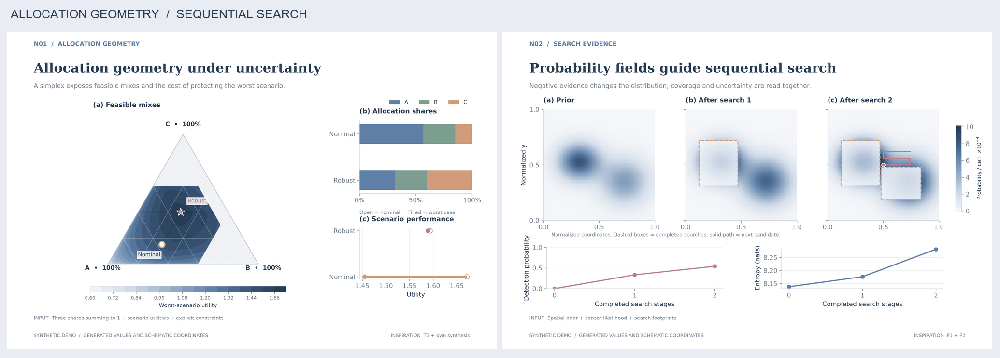
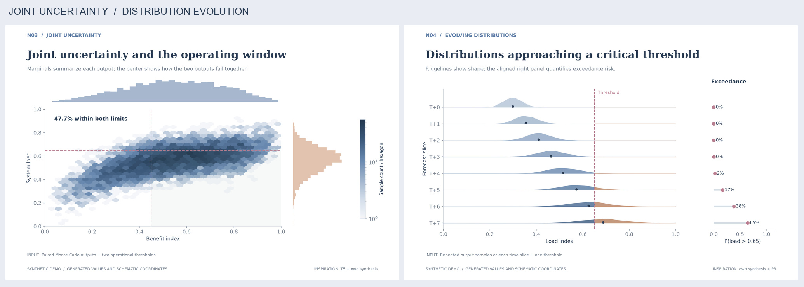
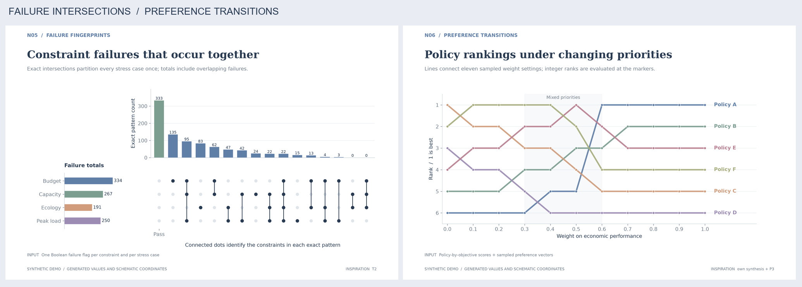
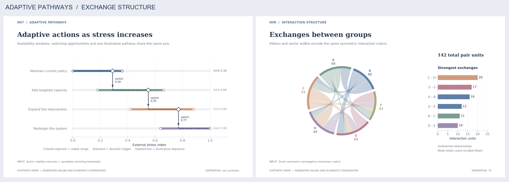
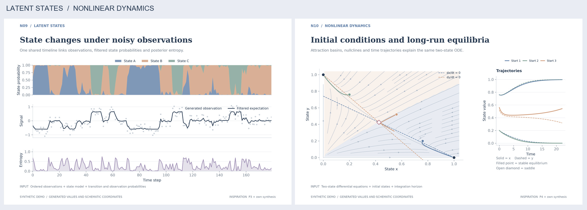
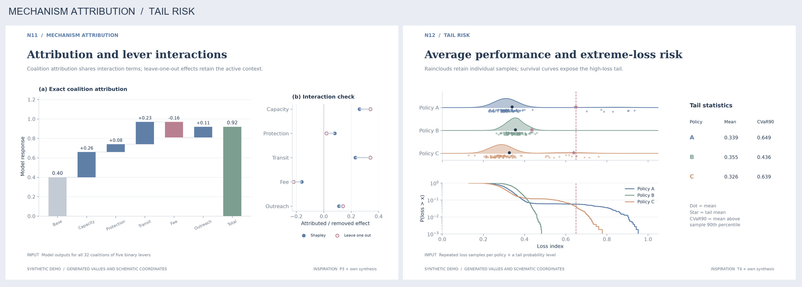

**MCM / ICM 新结构样张**

本批包含 12 张复合图，使用合成数据与示意坐标。新检索的四篇 2024 O 奖论文及原始制图资料见[网络检索与落地说明](research/网络检索与落地说明.md)。每图附有所需输入和实现方法。

完整图册为 MCM_B_New_Structures.pdf，共 14 页。PNG 为 3420 × 2220 像素、300 dpi，SVG 保留图形及文字对象。

| 编号 | 样图 | 回答的问题 | 适配复杂度 | 查看 |
|---|---|---|---|---|
| N01 | 三元配比与鲁棒选择 | 三类投入如何分配，稳健性要付出多少代价？ | 中 | [PNG](PNG/N01_allocation_simplex.png) · [SVG](SVG/N01_allocation_simplex.svg) |
| N02 | 概率场、搜索路径与证据更新 | 新搜索证据出现后，下一步去哪里？ | 中 | [PNG](PNG/N02_probability_search.png) · [SVG](SVG/N02_probability_search.svg) |
| N03 | 带边缘分布的联合不确定性图 | 两个指标的联合达标范围在哪里？ | 低 | [PNG](PNG/N03_joint_uncertainty.png) · [SVG](SVG/N03_joint_uncertainty.svg) |
| N04 | 分布山脊与超阈风险图 | 风险在何时集中，尾部如何变化？ | 低 | [PNG](PNG/N04_distribution_ridges.png) · [SVG](SVG/N04_distribution_ridges.svg) |
| N05 | 约束失效交集 UpSet 图 | 预算超支和容量超限是否经常一起发生？ | 低 | [PNG](PNG/N05_constraint_upset.png) · [SVG](SVG/N05_constraint_upset.svg) |
| N06 | 偏好变化的排名编织图 | 偏好改变后，推荐方案会不会换位？ | 低 | [PNG](PNG/N06_ranking_braid.png) · [SVG](SVG/N06_ranking_braid.svg) |
| N07 | 适应路径地铁图 | 条件恶化时，何时升级、从哪条路径切换？ | 中 | [PNG](PNG/N07_adaptation_pathways.png) · [SVG](SVG/N07_adaptation_pathways.svg) |
| N08 | 守恒弦图与主联系排序 | 哪些群体之间联系最强，强度如何分布？ | 中 | [PNG](PNG/N08_interaction_chords.png) · [SVG](SVG/N08_interaction_chords.svg) |
| N09 | 潜在状态色带与不确定性联动图 | 系统是在换状态，还是观测本身波动？ | 中 | [PNG](PNG/N09_state_probability_ribbon.png) · [SVG](SVG/N09_state_probability_ribbon.svg) |
| N10 | 吸引域、零增长线与动态轨迹相图 | 相同政策为何可能导向不同长期状态？ | 中 | [PNG](PNG/N10_phase_portrait.png) · [SVG](SVG/N10_phase_portrait.svg) |
| N11 | 精确归因瀑布与消融对照 | 收益来自哪个措施，交互项有多重要？ | 中 | [PNG](PNG/N11_attribution_waterfall.png) · [SVG](SVG/N11_attribution_waterfall.svg) |
| N12 | 雨云图、尾部风险与极端损失 | 均值相近的方案，哪个更容易遭遇大损失？ | 低 | [PNG](PNG/N12_raincloud_tail_risk.png) · [SVG](SVG/N12_raincloud_tail_risk.svg) |

复现入口为 generate_structures.py，全部示例输入另存于 demo_arrays.npz，验证记录为 validation.json。适配复杂度描述图形与计算结构，正式比赛所需工期取决于模型和数据准备。

