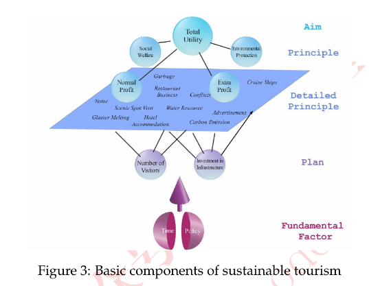
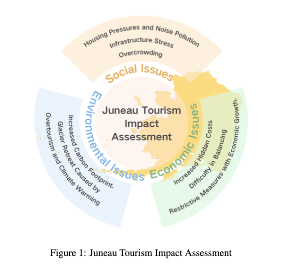
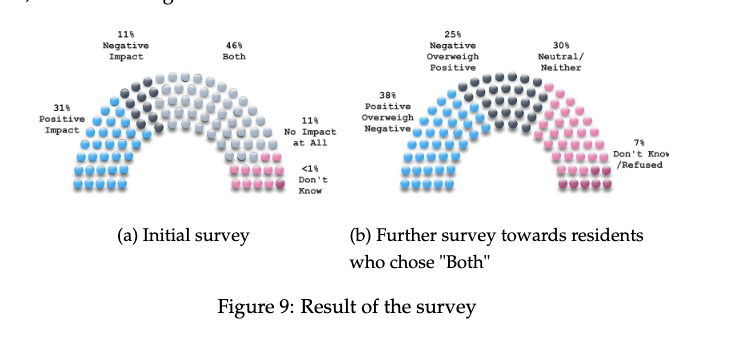
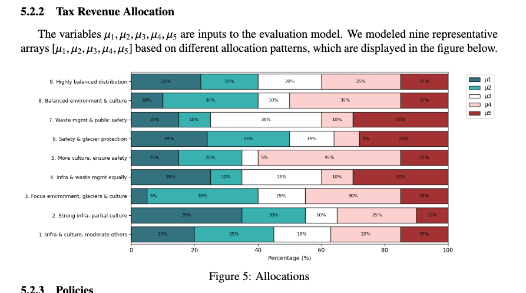
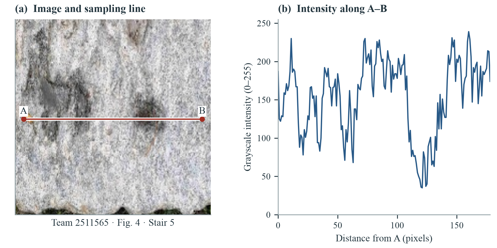

# Improving readability of article

## Chart

Always use charts when you wanna to give an array or a set of data.  
you can create small chart to comment before giving equations to greatly improve readability, since align notations is extreme trivial in reading an article.  

## Diagram

diagram is picture that is composed of basic element to visualize logical relationship or procedures.  
remember do not list notations in these diagram since it's too hard for readers to familiarize notations quickly in your article.  
use **drawio** to create diagram.  
ep. don't use many color. 

## Plot

**plot with matlab in great color:**  
https://www.zhihu.com/people/hei-gou-52/posts  
Plot is aimed to visualize database or give an **intrinsic** impression towards readers.  
When we need to show multiple variables, it's good to showcase them in following maps. multi-layer plot is also a good idea, since it can give a intuitive comparison to different conditions. 

- vector map
- heat map
- 3-D equalheight map
- line map

Generally, it's not good to contain too many data in a plot. a better way to show them is to combine the chart with plot. 

## Color and comment

every plot need comment to emphasize the result and draw to conclusion. so need to remember comment without using too much notations. you can put the result into the graph instead of writing them in the next part. 

## Five basic fundemental language pattern.

1. Summary, the inventory part 
2.  Explain data, explain with direct and intuitive data.
3.  logical deduction
4.  set constrain
5.  Rebutter, argue with wrong idea

这五种语言模式不可以有什么AI味，免责声明，强行比喻，无效的数据解释。避免过多的解释数据，而轻视了物理意义。

比如模型不可以对一堆中间量进行数学解释，因为公式已经完全解释过他们了

### Fundemental diagram 基本的模型构建图

是用现实的物体，具体的方式来体现模型。对model的物理意义的intuitive直观展示，避免用一些乱七八槽的流程图很很多的算法图，这些算法都很简单，而且是现成的根本不需要再额外用图片来解释他。

### 逻辑图，流程图

避免只解释数学公式，或者只空谈措施的流程图。要做到：

1. 选择两个最重要个公式，讲述作用
2. 是怎么跟notation里面的变量发生关系的
3. 最初的输入是什么，最终的目的是什么

### 综合政策地图

对seneario parameter 的取值，需要有一组向量来，而不是直接取平均值。这一组向量每种又对应了不同的政策强度和侧重。需要有对这一块的分类讨论，经常集中在model2中。

  
### 给模型机制挑一张图

- 两个更新周期互相提供输入时，用[双时钟](mcm_library/latex/mechanisms/m1_two_clocks.png)。让读者沿两条交接箭头各读出一个量，知道它何时固定、何时汇总。
- 当守恒式里有多种损失时，用[存量与流量示意图](mcm_library/latex/mechanisms/m1_bucket.png)。在图上顺着流入追踪一遍，定位在途损失、库存消耗和溢流各发生在哪里。
- 维护规则跟随年龄、结算跟随日历时，用[批次时间轴](mcm_library/latex/mechanisms/m2_cohort_idea.png)。同一日历时刻纵向比较，同时在运的各批次可能处于不同阶段。
- 解释转移矩阵的一行时，用[状态格与矩阵对照图](mcm_library/latex/mechanisms/m3_matrix_discrete.png)。给一个具体出发格及其去向，在矩阵中对应着色。

[可编辑源码、编译方式与换题说明](mcm_library/latex/mechanisms/README.md)

### 真实图片和数据如何对应

把[台阶照片与灰度剖面](examples/image_data/line_profile.png)并排看：左侧 A、B 指出测量位置，右侧横轴从 A 开始计数。读者能回到照片上定位曲线中的明暗变化。若用于设备检测，可沿焊缝或试件表面标取样线，纵轴写实际测得的物理量。

当两边靠对象编号关联时，可参考[站号与覆盖率](examples/image_data/station_statistics.jpg)或[台阶样本与深度估计](examples/image_data/README.md)。城市交通图可用[区域框与局部影像](examples/image_data/road_zoom.jpg)定位同一路段。并列给出景观和问卷时，要分别交代影像来源和调查分母。

[图像与数据案例、来源页码、可运行示例](examples/image_data/README.md)
