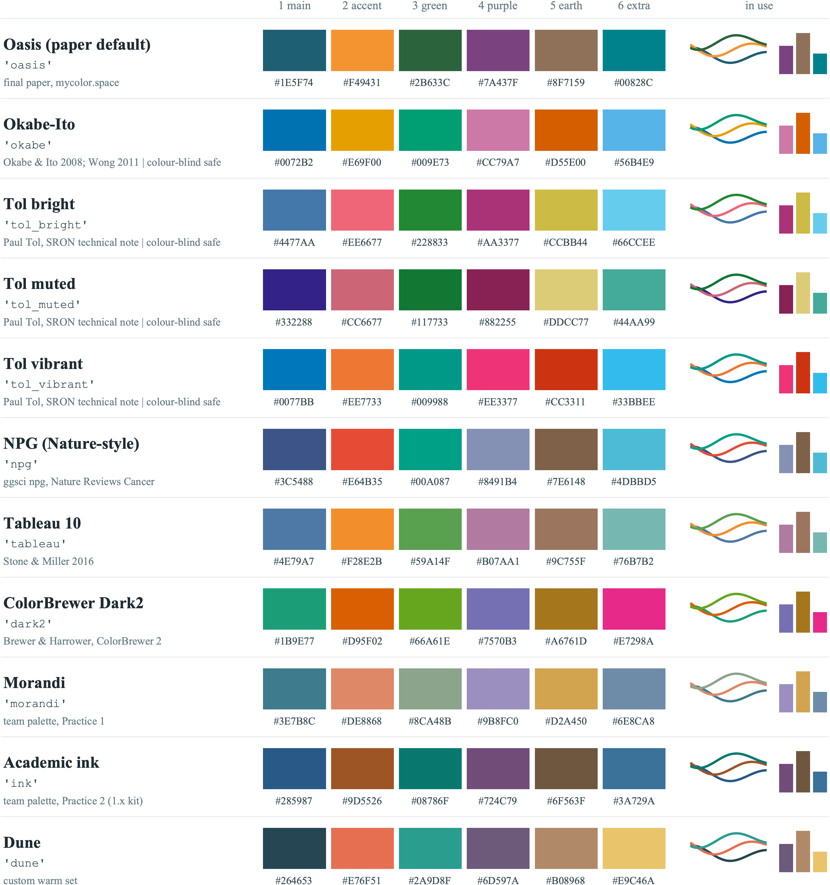
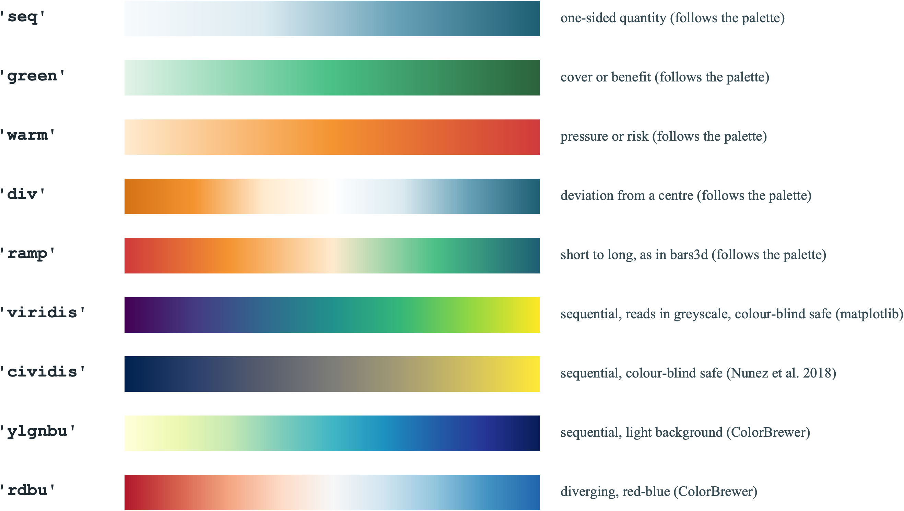

# 美赛绘图包 2.0（MATLAB + TikZ）

这个包以 2026 校赛 B 题终稿（`Paper/main.pdf`）的图为准：数据图用 MATLAB，示意图用 TikZ，配色和字体全文统一。1.x 的 Python 绘图接口已移除，它覆盖的图型（雷达、热力、Pareto、可行域、盈亏平衡、龙卷风、桑基、山脊、雨云等）用 MATLAB 按终稿样式重写在 `matlab/charts/`。旧版从 git 历史（提交 `a9fd199`）取回。

| 目录 | 内容 |
|---|---|
| [matlab/](matlab/) | 样式函数，新题直接用 |
| [matlab/charts/](matlab/charts/) | 25 个通用图型函数，只收数据、不读文件 |
| [matlab/paper_figures/](matlab/paper_figures/) | 终稿 10 张数据图的源码，按图型当模板改 |
| [matlab/more_figures/](matlab/more_figures/) | 同一风格、终稿没用上的 5 张 M2 图 |
| [tikz/](tikz/) | 终稿 6 张示意图的源码和共用色板 |
| [gallery/](gallery/README.md) | 图册：配色版面、每个图型一张预览、终稿各图 |
| [references/](references/ImproveReadability.md) | 可读性指南和 O 奖构图样例 |

## 新题上手

```matlab
addpath('<包路径>/matlab', '<包路径>/matlab/charts');
S = paper_style('out', 'Paper/Figure');     % 色板 S.c、字号 S.fs、版宽 S.textW
% S = paper_style('out', 'Paper/Figure', 'palette', 'okabe');   % 换一套配色
fig = new_figure(S.textW, 6.2);             % 按印刷尺寸（cm）建画布
tl = tiledlayout(fig, 1, 2, 'TileSpacing', 'compact', 'Padding', 'compact');
ax = nexttile(tl); style_axes(ax, S, 'y');  % 外向刻度、浅色网格
plot(ax, x, y, '-', 'Color', S.c.water, 'LineWidth', 1.4);
panel_title(ax, '(a) Title', S);
frame_axes(ax, S);                          % 细边框，放在定好坐标范围之后
save_fig(fig, 'my_figure', S);              % 矢量 PDF + 400 dpi PNG
```

`matlab -batch demo_charts`（在 `matlab/` 下）用合成数据把 25 个图型各画一张，输出到 `gallery/charts/`。`demo_charts(输出目录, 'npg')` 可以换配色重画一遍。

| 函数 | 作用 |
|---|---|
| `paper_style` | 色板、字体、字号、版宽，以及输出目录和数据目录 |
| `kit_palette` / `export_tikz_palette` | 11 套配色；把当前配色导出成 TikZ 色板文件 |
| `new_figure` / `save_fig` | 按厘米建画布；导出 PDF 和 PNG |
| `style_axes` / `frame_axes` / `panel_title` | 坐标轴样式、闭合细框、左对齐加粗分图标题 |
| `add_overbar` | 给文字末尾的 W 加上划线（MATLAB 的 TeX 模式没有 `\overline`） |

## 配色



```matlab
S = paper_style('palette', 'npg');                    % 之后所有图型函数和终稿模板都按这套颜色画
export_tikz_palette(S, 'Paper/Figure/paper_palette.tex');   % TikZ 示意图同步换色
kit_palette()                                          % 列出全部名称
```

每套配色都是 6 个颜色，按角色排好：1 主色、2 强调、3 绿、4 紫、5 土色、6 备用。换配色时角色不变，所以同一段出图代码不用改；上限和阈值在任何配色下都是红色虚线。每套配色的实际效果见 [gallery/palettes/](gallery/README.md#配色)，各有一张“轨迹 + 构成条 + 相关矩阵”的样图。

| 名称 | 来源 | 什么时候用 |
|---|---|---|
| `oasis` | 终稿，[mycolor.space](https://mycolor.space) 以 #1E5F74 为基色 | 默认；水、植被、风沙题材 |
| `okabe` | Okabe & Ito 的 [Color Universal Design](https://jfly.uni-koeln.de/color/)，Wong 2011 在 Nature Methods 推荐 | 色盲友好，拿不准时选它 |
| `tol_bright` / `tol_muted` / `tol_vibrant` | [Paul Tol 的配色方案](https://tol-colors.readthedocs.io/en/latest/colorsets.html) | 色盲友好；bright 通用，muted 适合大面积填充，vibrant 适合细线和小点 |
| `npg` | [ggsci](https://github.com/nanxstats/ggsci) 的 npg，仿 Nature Reviews Cancer | 冷暖对比强，适合对照两三个方案 |
| `tableau` | [Tableau 10](https://www.tableau.com/blog/colors-upgrade-tableau-10-56782)（Stone & Miller 2016） | 柔和，类别多的柱条图 |
| `dark2` | [ColorBrewer](https://colorbrewer2.org) Dark2 | 深色，细线和文字标注清楚 |
| `morandi` | 队内 Practice1 的低饱和配色 | 大面积色块，政策或社会类题目 |
| `ink` | 队内 Practice2 的 Python 版配色 | 深色学术风，接近旧图 |
| `dune` | 自拟暖色组合 | 沙漠、能源、气候题材 |

npg、tableau、dark2 和三套队内配色没有经过色盲安全验证，用它们时让线型或标记形状也跟着系列变。



色带用 `kit_cmap(S, 名称)` 取，或直接把名称传给 `heatmap_grid`、`contour_field`、`surface3d`、`ridge_lines` 的 `cmap` 选项。前五条跟随当前配色；后四条是固定的：viridis 和 cividis 来自 matplotlib，打印成灰度仍然有序；ylgnbu 和 rdbu 来自 ColorBrewer。单向的量用顺序色带，围绕一个有含义的中心（0、基准值）的偏差才用发散色带。

## 通用图型（`matlab/charts/`）

每个函数画在你给的坐标轴上，轴标签和分图标题由你自己加。选项见各文件开头的注释，最短调用见 `matlab/demo_charts.m`。

| 想让读者看到什么 | 函数 | 预览 |
|---|---|---|
| 几组、几个系列的数值并排比 | `grouped_bars` | [预览](gallery/charts/grouped_bars.png) |
| 各方案内部的构成或占比 | `stacked_bars` | [预览](gallery/charts/stacked_bars.png) |
| 一个总量怎样一步步变成另一个 | `waterfall_bars` | [预览](gallery/charts/waterfall_bars.png) |
| 每个对象前后两次的变化 | `dumbbell_rows` | [预览](gallery/charts/dumbbell_rows.png) |
| 单参数敏感性，谁影响最大 | `tornado_bars` | [预览](gallery/charts/tornado_bars.png) |
| 各情景相对基准差多少 | `lollipop_rows` | [预览](gallery/charts/lollipop_rows.png) |
| 估计值落在参考区间内吗 | `interval_rows` | [预览](gallery/charts/interval_rows.png) |
| 几组样本的分布形状 | `raincloud_rows` | [预览](gallery/charts/raincloud_rows.png) |
| 一条分布或日变化曲线在多组间的差别 | `ridge_lines` | [预览](gallery/charts/ridge_lines.png) |
| 几条情景轨迹和各自的区间 | `band_lines` | [预览](gallery/charts/band_lines.png) |
| 两个离散维度上的数值，或相关矩阵 | `heatmap_grid` | [预览](gallery/charts/heatmap_grid.png) · [发散色带](gallery/charts/heatmap_grid_div.png) |
| 两三个方案在多个指标上的画像 | `radar_chart` | [预览](gallery/charts/radar_chart.png) |
| 一个总量的份额 | `donut_share` | [预览](gallery/charts/donut_share.png) |
| 从来源到去向的流量 | `alluvial_flow` | [预览](gallery/charts/alluvial_flow.png) |
| 节点之间的联系强弱 | `network_graph` | [预览](gallery/charts/network_graph.png) |
| 排名随阶段的变化 | `bump_ranks` | [预览](gallery/charts/bump_ranks.png) |
| 任务的起止时间和工期 | `gantt_rows` | [预览](gallery/charts/gantt_rows.png) |
| 候选解、非支配前沿和选中的方案 | `pareto_scatter` | [预览](gallery/charts/pareto_scatter.png) |
| 线性约束围成的可行域和最优点 | `feasible_region` | [预览](gallery/charts/feasible_region.png) |
| 成本与收益何时交叉 | `break_even` | [预览](gallery/charts/break_even.png) |
| 两个连续输入下的响应（平面） | `contour_field` | [预览](gallery/charts/contour_field.png) |
| 两个连续输入下的响应（立体） | `surface3d` | [预览](gallery/charts/surface3d.png) |
| 二维动力系统的方向场、零斜线和轨迹 | `phase_portrait` | [预览](gallery/charts/phase_portrait.png) |
| 构成随时间的变化，或以流图表示 | `stacked_area` | [预览](gallery/charts/stacked_area.png) · [流图](gallery/charts/stacked_area_stream.png) |
| 小型离散网格上的 3D 柱 | `bars3d` | [预览](gallery/charts/bars3d.png) |

辅助函数：`kit_cmap`（由色板生成的顺序、发散色带）、`kit_legend`、`ink_on`（按底色选黑字或白字）、`fit_equal`（让雷达图、环形图、网络图撑满所在格子）。

在 `tiledlayout` 里用这些函数时，先把所有格子建好再画，`frame_axes` 放在每个分图的最后调用。

## 终稿的图当模板

| 论文要回答的问题 | 模板 | 预览 |
|---|---|---|
| 问题涉及哪几个因素，现场什么样？ | `paper_figures/fig_intro_factors.m` | [图 1](gallery/intro_factors.jpg) |
| 全文怎么衔接，每个模型的输入、工具、输出是什么？ | `tikz/workflow.tex` | [图 2](gallery/workflow.png) |
| 研究对象在哪里，各站观测到多少？ | `paper_figures/fig_data_stations.m` | [图 3](gallery/data_stations.jpg) |
| 一个模型的输入、变量链、控制方程和输出？ | `tikz/m1_layers.tex`、`tikz/m2_layers.tex` | [图 4](gallery/m1_layers.png)、[图 11](gallery/m2_layers.png) |
| 两个时间尺度怎么交接？ | `tikz/m1_two_clocks.tex` | [图 5](gallery/m1_two_clocks.png) |
| 守恒量从哪进、从哪出？ | `tikz/m1_bucket.tex` | [图 6](gallery/m1_bucket.png) |
| 分段函数的阈值在哪，季节曲线如何？ | `paper_figures/fig_m1_stress_season.m` | [图 7](gallery/m1_stress_season.png) |
| 多站观测和预测对得上吗？ | `paper_figures/fig_m1_cover_series.m` | [图 8a](gallery/m1_cover_series.png) |
| 各情景随时间怎么走？ | `paper_figures/fig_m1_scenarios.m` | [图 8b](gallery/m1_scenarios.png) |
| 投入加大，长期状态怎么变？ | `paper_figures/fig_m1_water_curve.m` | [图 9](gallery/m1_water_curve.png) |
| 单参数敏感性谁大谁小？ | `paper_figures/fig_m1_sensitivity.m` | [图 10](gallery/m1_sensitivity.png) |
| 按年龄管理、按日历结算的批次怎么排？ | `tikz/m2_cohort_idea.tex` | [图 12](gallery/m2_cohort_idea.png) |
| 多年计划：建多少、花多少、比例如何？ | `paper_figures/fig_m2_plan.m` | [图 13](gallery/m2_plan.png) |
| 随机冲击下的轨迹、恢复和累计效益？ | `paper_figures/fig_m3_resilience.m` | [图 15](gallery/m3_resilience.png) |
| 两个情景参数的网格，加上各机制对照？ | `paper_figures/fig_m3_sensitivity_val.m` | [图 16](gallery/m3_sensitivity_val.png) |
| 几个已求解目标的成本与效益？ | `more_figures/fig_m2_tradeoff.m` | [预览](gallery/m2_tradeoff.png) |
| 十几个情景对三个指标的影响？ | `more_figures/fig_m2_sensitivity.m` | [预览](gallery/m2_sensitivity.png) |
| 保本价格随时间怎么变，哪些年值得投？ | `more_figures/fig_m2_pv_screen.m` | [预览](gallery/m2_pv_screen.png) |
| 用量离上限多近，哪个月最紧？ | `more_figures/fig_m2_water.m` | [预览](gallery/m2_water.png) |
| 各批次的状态和合计随年份怎么变？ | `more_figures/fig_m2_cohorts.m` | [预览](gallery/m2_cohorts.png) |

图号是终稿里的编号。图 14 是 `Paper/Section/model3.tex` 里的四框内联 TikZ，没有单独文件。

## 画法约定

- **颜色有含义，全文固定。** 默认配色里水用青蓝 `water`，植被用绿 `veg`，风沙用棕 `sand`，资金和 PV 用橙 `accent`/`pvDark`，情景对照用紫 `plum`，上限和阈值一律红色虚线 `limit`。换题时先定每个角色代表什么，再选一套配色；一篇论文只用一套，一张图里不超过 6 种颜色。
- **按印刷尺寸画。** 整版宽 16.5 cm，半版 8.1 cm；字号 7–8.5 pt，字体 Times New Roman。LaTeX 里用 `\includegraphics[width=\linewidth]`，不再缩放。
- **能直接标就不用图例。** 曲线旁写名字，颜色与线一致；关键数值（如“65.5% retained”）标在图上，由数据算出，不手写。
- **基准要一眼看到。** 基准行加浅底色和粗体，基准柱加深色边框，基准值画成灰色虚线。
- **3D 要有理由。** 小型离散网格用 `bars3d`，柱高和颜色表达同一个量，柱顶标数值；连续函数才用 `surface3d`；格子多了改用 `heatmap_grid`。
- **雷达图先归一化。** 各轴统一到同一范围、方向一致（越大越好），最多三条折线，图注写清归一化方法。
- **示意图只放关键变量。** 一张图最多两条公式，底层写原始输入，顶层写最终目的；完整符号表留给正文。

## 重画终稿的图

```sh
cd matlab/paper_figures && MCM_FIG_OUT=/tmp/kit_out matlab -batch make_paper_figures
cd matlab/more_figures  && MCM_FIG_OUT=/tmp/kit_out matlab -batch make_more_figures
cd tikz && for f in workflow m1_layers m2_layers m1_two_clocks m1_bucket m2_cohort_idea; do pdflatex $f.tex; done
```

- 数据图读项目里的 `Results/v7/` 和 `Data/v7/`。项目目录默认取本包上方含 `Results/v7` 的最高一层，也可以用 `paper_style('root', ...)` 指定。
- `fig_intro_factors` 和 `fig_data_stations` 还需要仓库根目录的 `Data/v7/raw/photos/` 和 `Data/v7/raw/basemap_tiles/`，`final/Data` 里没有这两个文件夹。
- 2026-11-24 在 MATLAB R2024b 和 TeX Live 2025 下重跑：15 张数据图的 PNG 与 `Paper/Figure/` 逐像素一致，6 张 TikZ 图与终稿所用 PDF 渲染一致。通用图型和 10 套新增配色只用合成数据试过，还没有用在论文里；`oasis` 配色导出的 TikZ 色板与 `tikz/paper_palette.tex` 逐项相同。
