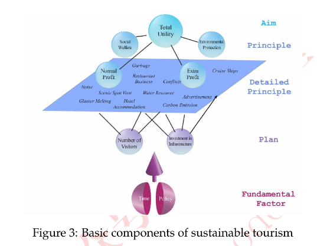
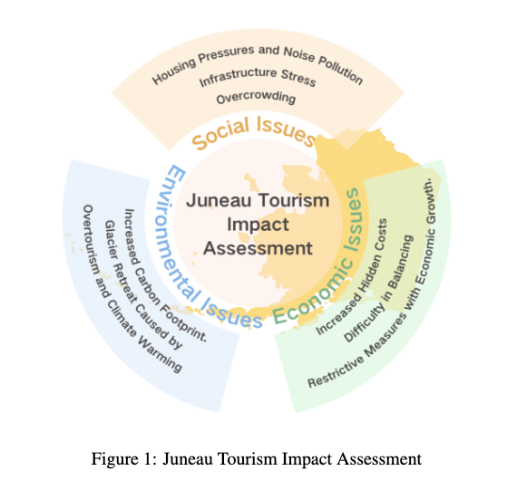
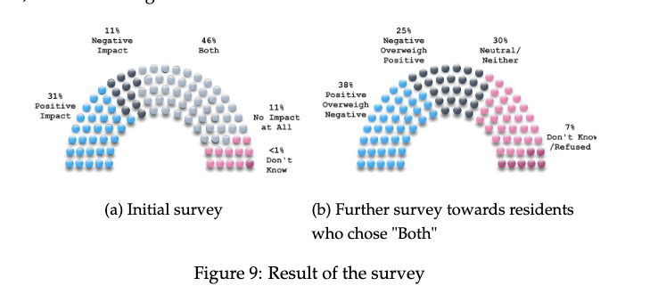
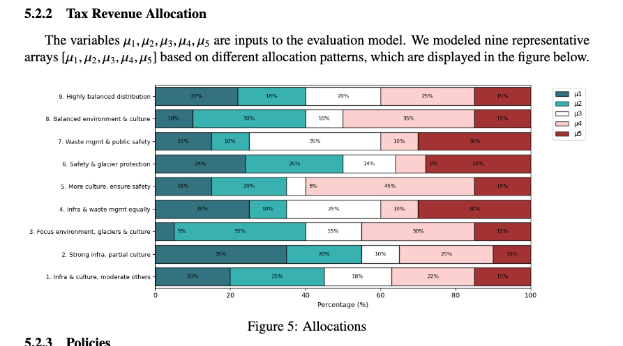

# Improving readability of article

## Chart

Always use charts when you wanna to give an array or a set of data.  
you can create small chart to comment before giving equations to greatly improve readability, since align notations is extreme trivial in reading an article.  

## Diagram

diagram is picture that is composed of basic element to visualize logical relationship or procedures.  
remember do not list notations in these diagram since it's too hard for readers to familiarize notations quickly in your article.  
use **drawio** to create diagram.  
ep. don't use many color. 

## Plot

**plot with matlab in great color:**  
https://www.zhihu.com/people/hei-gou-52/posts  
Plot is aimed to visualize database or give an **intrinsic** impression towards readers.  
When we need to show multiple variables, it's good to showcase them in following maps. multi-layer plot is also a good idea, since it can give a intuitive comparison to different conditions. 

- vector map
- heat map
- 3-D equalheight map
- line map

Generally, it's not good to contain too many data in a plot. a better way to show them is to combine the chart with plot. 

## Color and comment

every plot need comment to emphasize the result and draw to conclusion. so need to remember comment without using too much notations. you can put the result into the graph instead of writing them in the next part. 

## Five basic fundemental language pattern.

1. Summary, the inventory part 
2.  Explain data, explain with direct and intuitive data.
3.  logical deduction
4.  set constrain
5.  Rebutter, argue with wrong idea

这五种语言模式不可以有什么AI味，免责声明，强行比喻，无效的数据解释。避免过多的解释数据，而轻视了物理意义。

比如模型不可以对一堆中间量进行数学解释，因为公式已经完全解释过他们了

### Fundemental diagram 基本的模型构建图

是用现实的物体，具体的方式来体现模型。对model的物理意义的intuitive直观展示，避免用一些乱七八槽的流程图很很多的算法图，这些算法都很简单，而且是现成的根本不需要再额外用图片来解释他。

### 逻辑图，流程图

避免只解释数学公式，或者只空谈措施的流程图。要做到：

1. 选择两个最重要个公式，讲述作用
2. 是怎么跟notation里面的变量发生关系的
3. 最初的输入是什么，最终的目的是什么

### 综合政策地图

对seneario parameter 的取值，需要有一组向量来，而不是直接取平均值。这一组向量每种又对应了不同的政策强度和侧重。需要有对这一块的分类讨论，经常集中在model2中。

  
### 给模型机制挑一张图

- 一个模型要同时交代输入、控制量、核心变量链、控制方程和输出时，用[分层图](../gallery/m1_layers.png)。中间斜面只放关键变量链，上方的球写两条控制方程和最终目的，下方的球写决策量和原始输入。
- 两个更新周期互相提供输入时，用[双时钟](../gallery/m1_two_clocks.png)。让读者沿两条交接箭头各读出一个量，知道它何时固定、何时汇总。
- 当守恒式里有多种损失时，用[存量与流量示意图](../gallery/m1_bucket.png)。在图上顺着流入追踪一遍，定位在途损失、库存消耗和溢流各发生在哪里。
- 维护规则跟随年龄、结算跟随日历时，用[批次时间轴](../gallery/m2_cohort_idea.png)。同一日历时刻纵向比较，同时在运的各批次可能处于不同阶段。
- 全文总流程用[输入、工具、输出三列图](../gallery/workflow.png)。每个模型一行，行间箭头上写交给下一个模型的变量。

[可编辑 TikZ 源码](../tikz/)

### 真实图片和数据如何对应

先找一件读者能在两边认出来的东西，例如同一站点、同一条道路或同一块样本，再把这个对应关系画出来。

- 研究对象在哪里、各位置观测到多少：[站网底图与逐站统计](../gallery/data_stations.jpg)，地图和右侧统计图用同一套站号、分组和颜色。
- 用实景交代问题背景和几个管理因素：[中心实景加四张带标题条的小图](../gallery/intro_factors.jpg)，图注写清每张照片的作者和许可。
- 城市尺度的指标对应哪段道路：[路网与局部影像](oaward/road_zoom.jpg)，用红框把全局图中的区域和局部影像连起来。
- 实景与调查共同交代背景：[冰川实景、位置与居民调查](oaward/glacier_survey.jpg)，图注分别写影像来源和调查对象。
- 照片里的样本如何进入模型：[现场和样本照片](oaward/sample_photos.jpg)，按样本编号和后面的结果图对应。

### 样例出处

`oaward/` 中的图是往届 O 奖论文的节选，只用于团队查阅构图。用到新论文里时换成该题自己的照片和数据，并随图标注来源。

| 样例 | 出处 |
|---|---|
| [可持续旅游分层图](oaward/tourism_layers.png) | 2025 MCM B，Team 2501687，第 6 页，图 3 |
| [朱诺旅游影响分类](oaward/tourism_impact.png) | 2025 MCM B，Team 2509557，第 4 页，图 1 |
| [两阶段调查](oaward/survey_followup.png) | 2025 MCM B，Team 2501687，第 14 页，图 9 |
| [税收分配方案](oaward/revenue_mix.png) | 2025 MCM B，Team 2503268，第 12 页，图 5 |
| [冰川实景、位置与居民调查](oaward/glacier_survey.jpg) | 2025 MCM B，Team 2504448，第 3 页，图 1 |
| [巴尔的摩路网与局部影像](oaward/road_zoom.jpg) | 2025 MCM D，Team 2516219，第 9 页，图 4 |
| [现场和样本照片](oaward/sample_photos.jpg) | 2025 MCM A，Team 2511565，第 8 页，图 4 |
